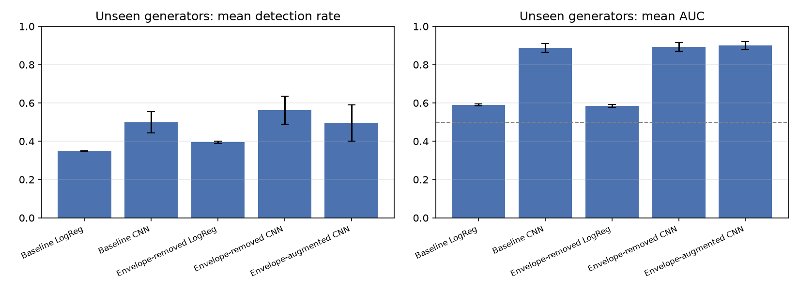
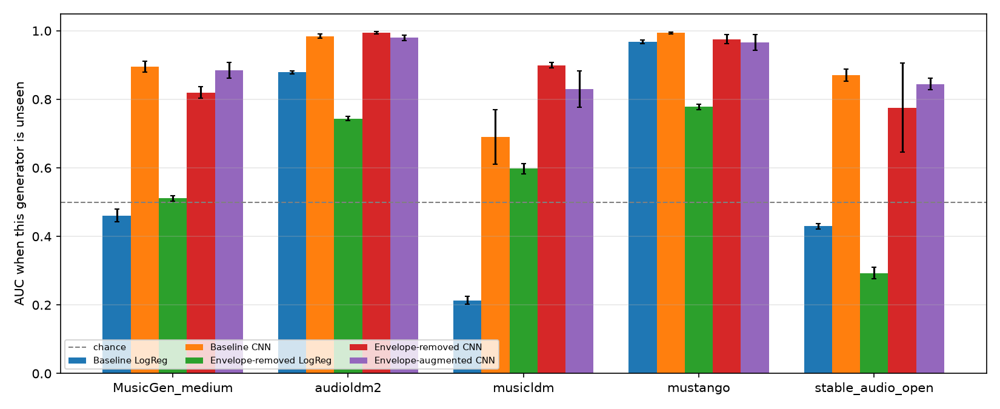

# AI Music Detection on Unseen Generators

This project is a pilot study on FakeMusicCaps. The main purpose is to test whether a detector of AI-generated music still works on a generator it has never seen. Specifically, if I train a detector on four text-to-music models, can it detect music from a fifth one? And if it cannot, what is the detector relying on?

I trained a logistic regression model and a small CNN to separate real music from AI-generated music, and tested them by leaving one generator out of training each time. The CNN reaches 97.5% balanced accuracy on the generators it was trained on, but it detects only about half of the clips from a generator it has never seen. I then tried two ways of changing the spectral envelope, to see whether the detectors could generalize better.



## Key results

The data contain 2,856 real clips from MusicCaps and 27,605 AI clips from 5 generators. Every clip is 10 seconds long, 16 kHz and mono. I split the data by MusicCaps ID, and all numbers are the mean and standard deviation over 3 seeds.

| Method | Seen generators: balanced acc. | Unseen generator: mean detection | Unseen generator: mean AUC |
|---|---|---|---|
| Baseline logistic regression | 0.910 ± 0.006 | 0.350 ± 0.001 | 0.590 ± 0.005 |
| Baseline CNN | 0.975 ± 0.005 | 0.499 ± 0.055 | 0.887 ± 0.022 |
| Envelope-removed logistic regression | 0.750 ± 0.010 | 0.394 ± 0.008 | 0.585 ± 0.006 |
| Envelope-removed CNN | 0.947 ± 0.011 | 0.562 ± 0.074 | 0.893 ± 0.022 |
| Envelope-augmented CNN | 0.966 ± 0.009 | 0.495 ± 0.095 | 0.901 ± 0.020 |

The second table shows the AUC on the held-out generator.

| Method | AudioLDM 2 | MusicLDM | Mustango | MusicGen | Stable Audio Open |
|---|---|---|---|---|---|
| Baseline logistic regression | 0.879 | 0.214 | 0.968 | 0.461 | 0.430 |
| Baseline CNN | 0.984 | 0.690 | 0.994 | 0.895 | 0.871 |
| Envelope-removed CNN | 0.994 | 0.900 | 0.976 | 0.820 | 0.776 |
| Envelope-augmented CNN | 0.980 | 0.830 | 0.966 | 0.884 | 0.845 |



The results show four things.

1. There is a large gap between seen and unseen generators. The CNN reaches 0.975 balanced accuracy on seen generators, but its detection rate on an unseen one is only about 0.50.
2. A simple detector can get it backwards. The logistic regression on spectral statistics gives unseen MusicLDM clips lower AI scores than real music (AUC 0.21), which means it rates them as more real than real music.
3. Removing the spectral envelope does not help every generator. It makes the CNN better on MusicLDM (AUC 0.69 to 0.90), but it hurts MusicGen and Stable Audio Open.
4. How hard a generator is to detect seems to follow its architecture. AudioLDM 2 and Mustango decode through a mel-spectrogram VAE and HiFi-GAN, like two of the training generators, and every CNN still detects 0.78 to 0.99 of their clips when they are unseen. MusicLDM has the same design, but it fails because of its spectral envelope, and envelope removal helps with it. MusicGen (EnCodec tokens) and Stable Audio Open (waveform VAE) stay hard to detect for every CNN (detection 0.18 to 0.34). This is a hypothesis, since I have not tested it directly.

## Method in brief

The input is a 128-band log-mel spectrogram (0–8 kHz, 1,024-sample window, 512-sample hop) for each 10-second clip, which is a 128 × 313 image. I subtracted each clip's overall mean (in dB), which removes loudness differences between generators.

I used two detectors. The first is a logistic regression on each band's mean and standard deviation over time (256 numbers per clip). The second is a small 4-block CNN on the full spectrogram. Both use class weights, since there are fewer real clips than AI clips.

For envelope removal (`cmn()` in `exp3_generalize.py`), I subtracted from each of the 128 bands its own time average within the clip, at both training and test time, for both detectors. What is left is how each band changes over time, and the clip's overall EQ curve (brighter or darker, a steep high-frequency drop) is gone.

For envelope augmentation (`augment()` in `exp3_generalize.py`, CNN only), I changed the envelope randomly during training instead. Each training clip gets a random linear tilt across the bands (up to ±10 dB between the lowest and highest band). For a random half of the clips, every band above a random cutoff (band 80–127, about 2.5–8 kHz) is also lowered by 10–30 dB. Test clips are left unchanged.

For evaluation, I left one generator out each time. The detector is trained on real music against four generators, and tested on real music against the fifth. Splits are grouped by MusicCaps ID, and each of the 3 seeds changes both the split and the model initialization.

The full tables are in [`results/final/summary.md`](results/final/summary.md), and the per-seed numbers are in [`results/final/summary.csv`](results/final/summary.csv).

## How to reproduce

Tested on Windows 11, Python 3.12, PyTorch 2.11 (CUDA 12.8), NVIDIA RTX 5070 Ti 16 GB.

```bash
pip install -r requirements.txt
# PyTorch with CUDA (adjust to your GPU / CUDA version):
pip install torch torchaudio --index-url https://download.pytorch.org/whl/cu128
# ffmpeg is required for downloading real audio (Windows: winget install Gyan.FFmpeg)
```

1. Choose a working folder and point `FMC_ROOT` at it (see `paths.py`). Without it, a `workspace/` folder next to the scripts is used.
2. Download `FakeMusicCaps.zip` (12.9 GB) from [Zenodo record 15063698](https://zenodo.org/records/15063698) into that folder.
3. Run, in order:

```bash
python unzip_data.py
python download_musiccaps.py --browser firefox --sleep 5   # several hours; resumable
python extract_features.py                                  # ~2 min on GPU
python exp1_attribution.py
python exp1b_robustness.py
python final_runs.py                                        # ~45 min per seed, 3 seeds
```

A note on the real-audio download. YouTube rate-limits aggressive downloads, so the script uses one request stream with a delay, pauses automatically when it is blocked, and only marks a video as permanently missing when YouTube says it is private, removed or terminated. About half of the MusicCaps videos are no longer available.

## Script guide

This section explains every script, in the order you run them.

### Shared settings

`paths.py` sets `ROOT`, the working folder every script reads from and writes to. Set the environment variable `FMC_ROOT` to your data folder; otherwise a `workspace/` folder next to the scripts is used. Inside it:

```
<FMC_ROOT>/
  FakeMusicCaps.zip          downloaded from Zenodo
  data/fake/<generator>/     AI clips (from unzip_data.py)
  data/real/<ytid>.wav       real clips (from download_musiccaps.py)
  features/                  log-mel spectrograms (from extract_features.py)
  results/exp1 … final/      outputs of each experiment
```

### Step 0: `check_dataset.py`

This script lists what is inside `FakeMusicCaps.zip` without extracting it: how many audio files each folder holds and how much space they take, and whether any folder looks like real (MusicCaps) audio. It also prints your Python version, whether PyTorch is installed, and whether an NVIDIA GPU is available.

```
python check_dataset.py "D:\data\FakeMusicCaps.zip"
```

### Step 1: `unzip_data.py`

This script extracts the AI clips to `data/fake/<generator>/`, skipping macOS `__MACOSX` files. Rerunning skips files already extracted. Optional arguments: `python unzip_data.py <zip path> <output folder>`.

### Step 2: `download_musiccaps.py`

This script downloads the real music from YouTube, using the same MusicCaps captions that FakeMusicCaps used. For each entry it downloads only the 10-second excerpt and converts it to the same format as the AI clips (16 kHz, mono WAV), saved as `data/real/<ytid>.wav`.

- The list of clips (`musiccaps-public.csv`, 5,521 entries) is downloaded from Hugging Face on first run.
- The download can be resumed. Rerunning skips clips already downloaded and videos confirmed as gone.
- A video counts as permanently missing only when YouTube says it is private, removed, terminated or unavailable. Blocks ("sign in", "bot", rate limits, cookie problems) are retried next time, and failures are logged to `data/real_failed.csv`.
- The script waits between downloads, pauses automatically when it is blocked, and stops after repeated blocks.

| Option | Meaning |
|---|---|
| `--limit N` | Download only the first N clips (for testing) |
| `--shard i/n` | Split the work: run `0/3`, `1/3`, `2/3` in three windows without overlap |
| `--sleep S` | Minimum seconds between downloads (default 3) |
| `--browser NAME` | Use your browser's signed-in session when YouTube asks you to sign in (`firefox`, `edge`, `chrome`) |
| `--cookies FILE` | Or use an exported `cookies.txt` file. Never commit this file. |
| `--pause M` | Minutes to pause when blocked (default 60) |
| `--max-pauses K` | Stop completely after K pauses (default 4) |

MusicCaps audio comes from YouTube, so use it for local research only and do not redistribute it.

`debug_download.py` diagnoses a single failing download (for example, a file with no audio stream). It tries one video and prints what YouTube returned: `python debug_download.py --browser firefox [--id <YouTube ID>]`.

### Step 3: `extract_features.py`

This script turns each clip into a log-mel spectrogram, which is the input to every experiment.

- Each clip is loaded as mono, 16 kHz, exactly 10 seconds (padded with zeros or cut).
- It is split into short frames (1,024 samples ≈ 64 ms, moving 512 samples at a time). A Fourier transform gives the energy at each frequency in each frame.
- Frequencies are merged into 128 bands on the mel scale (spaced the way human hearing is), then converted to decibels.
- The result is a 128 (frequency) × 313 (time) image per clip. Generators often leave traces here that listeners cannot hear, such as missing high frequencies or regular textures.

Output: `features/<class>.npy` (N × 128 × 313, float16) and `features/<class>_names.json` (the file name for each row). The features are computed on the GPU. Rerun the script after downloading more real audio, and classes already computed are skipped. `--limit N` processes only N clips per class (for testing).

### Experiment 1: generator attribution (`exp1_attribution.py`)

This experiment classifies AI clips by generator (five classes), with two models.

- Model A is a logistic regression. For each of the 128 bands, I took the mean and standard deviation over time (256 numbers per clip), standardized them, and trained a linear classifier. It shows how far the simplest statistics go, and it is easy to interpret.
- Model B is a small CNN on the full 128 × 313 spectrogram. It has four blocks of 3×3 convolution, batch normalization, ReLU and 2×2 max pooling (16, 32, 64, 128 channels), followed by global average pooling, 30% dropout and a linear output. I trained it with Adam at a learning rate of 1e-3, and kept the epoch with the best validation balanced accuracy.

An important design choice is to split by caption instead of by clip. All five generators were prompted with the same MusicCaps captions. A random split would put clips from the same caption in both training and test sets, so a model could succeed by recognizing the content rather than the generator. Because of this, I split the data 70/15/15 by MusicCaps ID, so test captions are never seen in training.

Output: `results/exp1/results.json` and confusion-matrix figures.

### Experiment 1b: control experiments (`exp1b_robustness.py`)

This script runs two control experiments, to see what the model relies on.

1. The first checks whether the model only relies on loudness. Generators differ in average level (−20 to −33 dB). On a log spectrogram, changing the volume adds a constant to the whole image, so subtracting each clip's own mean removes loudness (`gain_normalize`). If accuracy stays high, this shows that the model has learned spectral shape, not volume.
2. The second checks where the generator's fingerprint is. The logistic regression sees only low frequencies (< 2 kHz: melody and bass) or only high frequencies (> 4 kHz: timbre detail and artifacts).

It also plots the average spectrum of each generator and of real music (`mean_spectra.png`). Output: `results/exp1b/`.

### Experiment 2: real or AI, including unseen generators (`exp2_detection.py`)

- In the standard setting, I train on real music against all 5 generators and test on the same generators.
- In the leave-one-generator-out setting, I remove one generator from training each time (real music against the other 4), then test how much of the removed generator's music is still detected as AI. This simulates new generators appearing after a detector is trained.

Some details are as follows.

- All inputs are loudness-normalized, because real music is generally louder and a model could otherwise judge by volume.
- The split is still by MusicCaps ID, so the real and AI clips of the same caption are always on the same side.
- There are fewer real clips than AI clips, so training uses class weights (`class_weight="balanced"` for logistic regression, `pos_weight` for the CNN).
- The metrics are balanced accuracy and AUC, which does not depend on a threshold. Detection rate is the share of AI clips predicted as AI at threshold 0.5, and real kept is the share of real clips predicted as real.

```
python exp2_detection.py                   # logistic regression + CNN (~15–20 min)
python exp2_detection.py --models logreg   # logistic regression only (under a minute)
```

Output: `results/exp2/results.json` and `detection_seen_vs_unseen.png`.

### Experiment 3: two interventions on the spectral envelope (`exp3_generalize.py`)

Experiment 2 shows that the detectors fail on unseen generators. My hypothesis is that they memorize each generator's spectral envelope (overall EQ curve, high-frequency cutoff), which differs between generators. I tried two interventions that force the model to ignore it.

1. Envelope removal (`cmn`) subtracts each band's own time average within each clip, leaving only the texture that changes over time. It is applied at training and test time, to both the logistic regression and the CNN.
2. Envelope augmentation (`aug`, CNN only) randomly tilts the spectrum by up to ±10 dB during training and, for half the clips, lowers every band above a random cutoff (band 80–127, about 2.5–8 kHz) by 10–30 dB. This makes the envelope an unreliable cue. Nothing is changed at test time.

Both interventions run the standard setting plus the 5 leave-one-out settings. `--variants cmn` runs only envelope removal. Output: `results/exp3/results.json`.

### Final runs: `final_runs.py`

This script runs Experiments 2 and 3 with 3 random seeds and reports the mean and standard deviation. Each seed changes both the train/validation/test split and the model initialization, to check that the conclusions do not depend on luck.

| Method | Meaning |
|---|---|
| `base_logreg`, `base_cnn` | Experiment 2 as is (loudness-normalized) |
| `cmn_logreg`, `cmn_cnn` | Envelope removed |
| `aug_cnn` | Envelope augmentation during training |

```
python final_runs.py              # 3 seeds, about 2–3 hours
python final_runs.py --seeds 0    # one seed, about 45 minutes
```

Each seed is saved when it finishes, and rerunning skips finished seeds. Output in `results/final/`: `summary.md`, `summary.csv`, `overview.png`, `per_generator_auc.png`, and one JSON file per seed.

## Limitations

This study has several limitations. Firstly, only 2,856 of the 5,521 real clips (52%) could still be downloaded, and the missing half is not random. The second limitation is that I used only 3 seeds, and several detection rates vary by 0.1 to 0.2 between seeds. Besides, the study covers five open-source generators and no commercial systems, and only two of the generators are outside the mel-spectrogram and HiFi-GAN group. All audio is 16 kHz, which removes the upper band of MusicGen (32 kHz) and Stable Audio Open (44.1 kHz). The real clips come from YouTube, which is lossy, while the AI clips are lossless, so part of what a detector learns may be the codec. Finally, the architecture explanation is a hypothesis, not a controlled test.

## Data and credits

- FakeMusicCaps: Comanducci, Bestagini, Tubaro, [arXiv:2409.10684](https://arxiv.org/abs/2409.10684), [code](https://github.com/polimi-ispl/FakeMusicCaps).
- MusicCaps captions and YouTube IDs: [google/MusicCaps](https://huggingface.co/datasets/google/MusicCaps). Real audio is downloaded by each user for research and is not redistributed here.

Author: Zongyou (Fred) Xiang · November 2026
